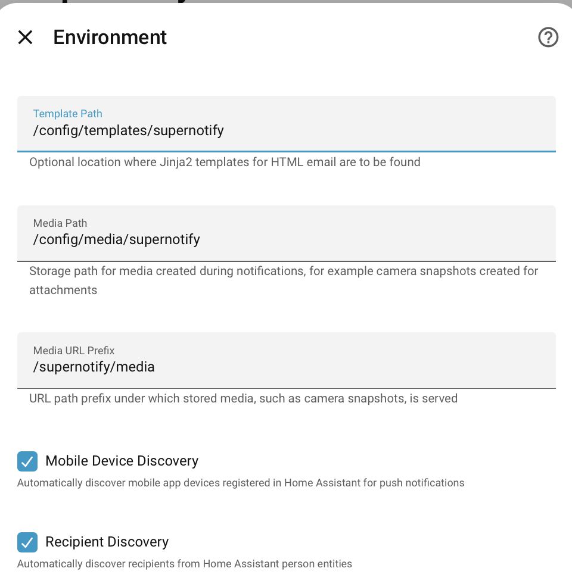
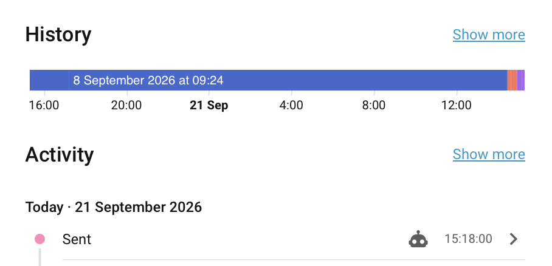

---
tags:
  - mobile_push
  - email
  - sms
  - people
  - recipients
  - occupancy
---
# People

While Home Assistant has both a `Person` and `User`, neither are directly useful or extensible for notifications and occupancy checks.

Supernotify adds a **People Registry** for notifications and occupancy, which builds on top of the Home Assistant entities ( and will be retired/adapted when Home Assistant does have this support). The term *Recipient* is used for what Supernotify manages, to distinguish from the Home Assistant terms.

With the `recipient` definition you can:

- Define an email address just once, and then refer to the target as `person.joe_soap` in notification calls
  - The person entity_id will automatically be replaced by the e-mail address for deliveries that take e-mail
- Likewise for phone numbers, for SMS, and for mobile devices
  - For mobile apps, with **automatic discovery**, the People Registry finds them for you, no config needed
- Also register custom targets, like Discord, Telegram etc IDs, that could be used in a *Generic* delivery
- Switch off a recipient, even if they were automatically discovered
- Set default targets for specific deliveries, so for example, an email address is always copied in on them
- Create a **Notify Entity** for that person, which will use any or all of the delivery transports enabled for them.
  - The Notify Entity for Recipient can also be a member of a **Notify Entity Group**

## Adding or Changing a Recipient

Recipients are set up in the integration, not YAML. Go to *Settings → Devices & services → Supernotify*, where
everyone [discovered](#automatic-recipient-discovery) is already listed as a recipient, and choose the cog by one
to change it. Anything set there adds to, or overrides, what Supernotify discovers for them, so you only need to
set what discovery can't find.

**Add recipient** is for someone who isn't discovered, usually someone who isn't a Home Assistant user at all,
like a relative to be e-mailed. Give their **Name**, or pick a **Person** or **User** when
[discovery](#automatic-recipient-discovery) is switched off. Someone with only a name has no mobile devices, and
never counts towards occupancy.

When adding or changing a recipient:

1. Fill in how to reach them:
    - **E-mail address** and **Phone number**, used by e-mail and SMS deliveries
    - **Alias**, a name to use in place of the Person's
    - **Enabled**, to switch the recipient off without removing them
    - **Mobile devices**, the mobile app devices to notify, from those registered in Home Assistant for them -
      untick any that shouldn't be used
    - **Mobile Device Discovery**, to pick up devices newly registered for them
    - **Targets** and **Custom targets**, more places to notify them, chosen just as in the `supernotify.notify`
      action - entities, devices, areas, floors and labels from the selector, and anything else as text, one per
      line: an e-mail address, a phone number, or `category:value`, such as `telegram_chat_id:12345`
2. Optionally pick one of the deliveries under **Change a delivery**, to set how it treats them, coming back
   to the form afterwards - see
   [Enabling, Disabling and Overriding Targets per Delivery](#enabling-disabling-and-overriding-targets-per-delivery).
   Submit with it left empty to save.

!!! note "Recipients from YAML"
    Recipients used to be set under `recipients:` in YAML. From version `2.18.0` those are imported into the
    integration when it starts, and a repair asks for them to be removed from the YAML, where they are ignored
    from then on. Until they are removed, a recipient deleted in the integration is imported again at the next
    restart.

## Automatic Recipient Discovery

The registry is automatically populated from all *Person* entities defined in HomeAssistant, unless you switch off **Recipient Discovery** in the integration's settings. And since each *Recipient* is automatically populated with all their mobile devices, there's a lot done without any configuration.

Everyone discovered is listed as a recipient in the integration. To leave one out, change their recipient, and
untick **Enabled** - deleting a discovered recipient only has them listed again at the next restart.

## Automatic Mobile App Discovery

By default, all the mobile devices registered in Home Assistant are discovered and associated with the recipient.

A mobile app with no `notify` action is skipped, since it can't be notified. An Apple Watch is the usual case, it registers with Home Assistant as its own mobile app, but takes its notifications by way of the paired iPhone.

This can be switched off by default for everyone from the UI config:



or per recipient, with **Mobile Device Discovery** when adding or changing them.

It is also possible to have discovery off by default, then selectively re-enabled for the folk you want, as recipients.

### Users without Person entries

Home Assistant optionally supports *Person* entries, useful for device tracking, but these are not mandatory.

From version `2.9.0`, Supernotify will also discover users and mobile app devices that only have user accounts, and generate recipients for them if auto discovery is on. Its still better to have Person records, to take advantage of occupancy and location tracking across multiple devices, plus `person` entities can be selected from the [Target Selector](https://www.home-assistant.io/docs/blueprint/selectors/#target-selector).

!!! note "Occupancy only counts People"
    Home Assistant uses the *Person* to say who is home or away, and Supernotify follows that. A recipient
    without a Person, such as the account a wall tablet logs in with, still gets notified, but never counts
    towards occupancy - it isn't home or away, so it can't make `ALL_AWAY` false, or make someone `LONE_HOME`.
    Being neither *in* nor *out*, it's always left out of `only_in` and `only_out` deliveries, which pick
    recipients by where they are. Deliveries whose occupancy is about everyone, like `all`, `any_in` or
    `all_out`, still include it whenever the People's occupancy lets them through.


### Disabling Auto Discovered Devices

Its usually easier to let Supernotify automatically find devices, and only intervene when there's one you
don't want, or isn't working. Change the person's recipient, and untick the device under **Mobile devices**
to stop it being used for notifications.

### Missing Mobile Apps

At start up, each enabled mobile device of a recipient is checked for a matching `notify.mobile_app_XXXX` action.
If there isn't one, for example because the phone was replaced or the Home Assistant app removed from it, a
repair is raised in Home Assistant. Remove the device from Home Assistant, or untick it as above, to clear
the repair, or ignore the repair in Home Assistant if the device is only away for a while.

A notification that includes a device with no action still goes to all the other targets. The device is
snoozed for a day, and the failed call is listed in the [archived notification](archiving.md).

## Sending Notifications

This means you can do multi-channel notification with a single reference to a `person` entity in a notification, and automatically the email, phone number, mobile app notification service, or whatever else is used as appropriate in each notification. This is all it takes:

```yaml title="Example Message to All Devices"
  - action: supernotify.notify
    data:
        title: Security Notification
        message: Something went off in the basement
```

Since by default everyone in the people list gets every notification, you don't even need to define targets at all in each automation/script/blueprint/appdaemon app.

If you want to pin it down to specific people, add a list of targets ( you can also mix and match this
target list with email addresses, notify entities, or direct mobile actions ).

```yaml title="Example Message to Some People"
  - action: supernotify.notify
    data:
        title: Warning All Kids
        message: Something happened and we are unhappy
        target:
         - person.johnny_mctest
         - person.jeanie_mctest
         - person.jolly_mctest
```
## Entities

Each recipient has a device of their own, listed under their recipient in the integration, with their [Notify Entity](#notify-entity) and a `switch.supernotify_recipient_XXXXX` entity, that is the recipient `enabled` flag. Turning it off ( by main UI, Developer Tools, automations, API or whatever ) disables the recipient, and turning it on enables them again.
This lasts across restarts and reloads, until the recipient's **Enabled** setting is changed, or it is put back as configured using the `supernotify.reset_overrides` action - see [Overrides](deliveries.md#overrides).

!!! warning "Deprecated"
    The recipient `binary_sensor.supernotify_recipient_XXXXX` is kept only for backward compatibility, and will be removed in a future version. It is read-only, mirroring the switch: writing its state no longer enables or disables the recipient. It is not created on a new install, and a repair is raised once in Home Assistant if you have it enabled.

This can be handy if someone should be temporarily switched off for notifications, or you want your own
automation to determine which people get notified when.

The entity also exposes the recipient attributes, such as email, mobile devices, target, custom data etc.

## Notify Entity

Every recipient is also automatically exposed as its own `notify.recipient_XXXXX` entity - a real, callable [Notify Entity](https://www.home-assistant.io/integrations/notify/), not just the diagnostic sensor above. It can be targeted directly from any automation, script or Lovelace UI that expects a standard Home Assistant notify target:

```yaml title="Example Automation Action"
    - action: notify.send_message
      target:
        entity_id: notify.recipient_new_home_owner
      data:
        message: Your bin needs to go out!!!
```

This goes through the full Supernotify delivery pipeline - occupancy, scenarios, personal delivery overrides, de-dupe, snooze - exactly as `notify.supernotify` or `supernotify.notify` does, just scoped to that one recipient instead of the whole People Registry.

There is also a `notify.recipient_XXXXX` action of the same name, for anything that only takes the name of a `notify` action, like the `notifiers` of the [Alert](https://www.home-assistant.io/integrations/alert/) integration.

Because it's an ordinary Home Assistant Notify Entity, it can be added as a member of a Home Assistant **Notify Group** helper ( *Settings → Devices & Services → Helpers → Add Helper → Group → Notify Group* ), to combine several recipients - or a subset of them - under one target, without needing a Supernotify Scenario just for that. These can be a mix of Supernotify provided and other platform Notify Entities.

!!! note
    Home Assistant restricts Notify Entity calls to only `message` and `title` - unlike `notify.supernotify`, there's no `data:` section for scenarios, priority, media, delivery selection etc. Use the main `supernotify.notify` action with an explicit `target:` if you need any of that for a specific recipient.

!!! warning "Current limitations"
    In the `target` of a delivery, scenario or another recipient, a recipient's notify entity is
    replaced by the recipient. Calling it, or a Notify Group containing it, while Supernotify is
    delivering a notification, such as from a script that a delivery runs, is ignored with a warning,
    so it can't make a loop. See [Scenario Notify Entity](scenarios.md#notify-entity) for the details.

Notify Entities get updated on every notification by Supernotify for that person, regardless of whether the Notify Entity itself was used for it. This also adds context of the original automation, so you can track what happened for a person.



## Enabling, Disabling and Overriding Targets per Delivery

**Change a delivery**, on the form for adding or changing a recipient, picks one of the deliveries - every Supernotify has some, even with no configuration - and sets how it treats that recipient, on top of whatever a *Scenario* or the delivery itself decides for everyone else:

- **Enabled** switches the delivery on or off just for that recipient, or leaves it as the delivery is set
- **Targets** and **Custom targets** add targets used only for that recipient on that delivery
- **Extra data** adds to the data the delivery sends for that recipient

Leaving all of these unset removes the change.

### Enabling a Delivery Just for One Recipient

A delivery doesn't need to be turned on for everybody to be useful to one person - setting **Enabled** for a delivery on a recipient switches it on for them alone, or conversely **Disabled** to switch it off just for that recipient.

Targets can also be set, independently of the enabled status, for only that recipient on that delivery. For example, a Slack delivery built with the [Generic Transport](../transports/generic.md#selecting-targets) that only Jane uses:

```yaml
delivery:
  slack:
    transport: generic
    action: notify.my_slack_service
    enabled: false
    options:
      target_categories: slack_channel

```

Then change Jane's recipient, choose **Change a delivery**, pick `slack`, set **Enabled** (leave it as the delivery is set if the slack delivery is usually enabled for everyone), and add `slack_channel:A20H2AN55DX` under **Custom targets**.

Nobody else is bothered by Slack messages, since `slack` was never enabled at the delivery level - only for Jane, and only because it was explicitly enabled for her.

### Disabling a Delivery for One Recipient

The opposite works too - a delivery that's already enabled for everybody can be switched off for one recipient, without touching the delivery itself:

```yaml
delivery:
  html_email:
    transport: email
    template: default.html.j2
```

Change `person.grumpy_teenager`'s recipient, choose **Change a delivery**, pick `html_email`, and set **Disabled**.

Everyone else still gets `html_email`; `person.grumpy_teenager` is left out of just that delivery, while still receiving anything else that applies to them (mobile push, other deliveries, and so on).

### Adding a Target for One Recipient

The same delivery change can add extra targets or data to a delivery that's already firing for everyone, rather than switching it on or off entirely - for example, CC'ing an assistant on the household's `html_email` delivery, by adding `assistant@myhome.net` under **Custom targets** for `html_email`.

**Enabled**, targets and **Extra data** can be combined as needed - **Disabled** always wins over any targets or data set alongside it, since a recipient who's opted out shouldn't still pick up delivery-specific extras.

## Devices Kept Out of Occupancy

Adding devices to the Person in Home Assistant affects the occupancy calculation that Home Assistant makes. So
if you have devices, like an iPad or laptop, that you would like to have notifications on, but aren't always with
you, adding them to Person might make it look as if you're home when its only an iPad sitting on a shelf.

**Mobile devices** offers every mobile app device registered in Home Assistant for the recipient's user, whether
or not it's one of the Person's trackers, so these can be notified without counting towards occupancy.

## References

- [Person Integration](https://www.home-assistant.io/integrations/person/)
