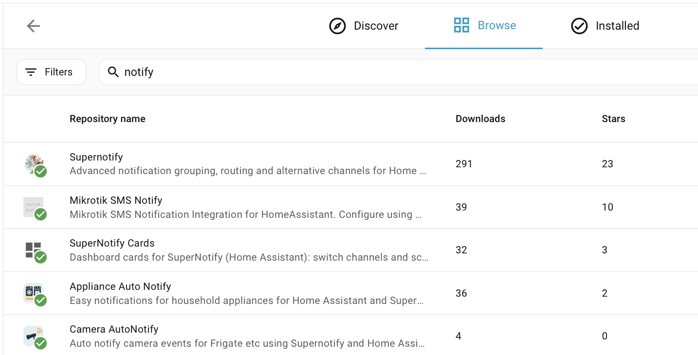

# Installation

## Über den Marketplace installieren { #install-from-the-marketplace }

Gehen Sie ab Home Assistant 2026.11 zu **Einstellungen → Marketplace**, suchen Sie nach **Supernotify** und öffnen Sie es, oder springen Sie mit dieser Schaltfläche direkt dorthin:

Wählen Sie **Installieren** und zur Bestätigung noch einmal **Installieren**. Supernotify ist im Katalog des Marketplace, es muss also kein eigenes Repository hinzugefügt werden. Braucht Home Assistant einen Neustart, bietet eine Reparatur unter **Einstellungen → System → Reparaturen** ihn an. Mehr dazu in der [Marketplace-Dokumentation](https://www.home-assistant.io/integrations/marketplace).

## Über HACS installieren { #install-from-hacs }

Vor Home Assistant 2026.11 war der Marketplace die separate Integration **HACS**. Stellen Sie also zuerst sicher, dass **HACS** installiert ist.

Falls nicht, hilft die [HACS-Anleitung](https://hacs.xyz/docs/use/). Supernotify gehört zu den Standard-Repositories in HACS, es muss also kein eigenes Repository eingerichtet werden.

Wählen Sie auf der HACS-Seite in Home Assistant **Supernotify** in der Liste der verfügbaren Integrationen, laden Sie es herunter und starten Sie Home Assistant neu.

{width=400}

## Die Integration hinzufügen { #add-the-integration }

Gehen Sie zu **Einstellungen → Geräte & Dienste → Integration hinzufügen** und suchen Sie nach **Supernotify**. Übernehmen Sie die Standardwerte.

## Erkennung und Standardwerte { #discovery-and-defaults }

Mehr ist nicht nötig, damit die ersten Benachrichtigungen funktionieren.

Supernotify schaut, was in Home Assistant bereits vorhanden ist, und findet:

- **Personen** - alle mit einer *Person* oder einem *Benutzer* in Home Assistant, samt den Telefonen und Tablets, auf denen sie die Home Assistant-App nutzen
- **Benachrichtigungswege** - Mobile Push, eine vorhandene SMTP-E-Mail-Integration, alle Notify-Entitäten und Geräte wie Alexa-Lautsprecher oder Gongs, falls vorhanden

Für jeden gefundenen Benachrichtigungsweg wird eine *Delivery* angelegt, dazu einige praktische wie `chime_siren_all` und `alexa_devices_announce_all`, wenn Sie solche Geräte haben.

Archiv, Duplikaterkennung und Aufräumeinstellungen lassen sich später über die Option **Konfigurieren** der Integration anpassen.

Jetzt [die erste Benachrichtigung senden](first_notification.md).
