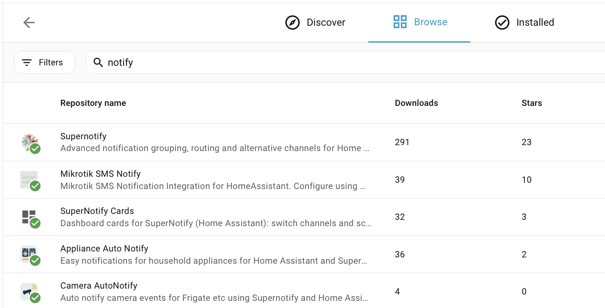

# Instalación

## Instalar desde el Marketplace { #install-from-the-marketplace }

A partir de Home Assistant 2026.11, ve a **Ajustes → Marketplace**, busca **Supernotify** y ábrelo, o ve directamente con este botón:

Selecciona **Instalar** y otra vez **Instalar** para confirmar. Supernotify está en el catálogo del Marketplace, así que no hace falta añadir ningún repositorio personalizado. Si Home Assistant necesita reiniciarse, una reparación en **Ajustes → Sistema → Reparaciones** te lo ofrece. Más información en la [documentación del Marketplace](https://www.home-assistant.io/integrations/marketplace).

## Instalar desde HACS { #install-from-hacs }

Antes de Home Assistant 2026.11, el Marketplace era la integración independiente **HACS**, así que primero asegúrate de tener **HACS** instalado.

Si no es así, consulta las [instrucciones de HACS](https://hacs.xyz/docs/use/). Supernotify es uno de los repositorios predeterminados de HACS, así que no hace falta configurar ningún repositorio personalizado.

En la página de HACS de Home Assistant, selecciona **Supernotify** en la lista de integraciones disponibles, descárgalo y reinicia Home Assistant.

{width=400}

## Añadir la integración { #add-the-integration }

Ve a **Ajustes → Dispositivos y servicios → Añadir integración** y busca **Supernotify**. Acepta los valores predeterminados.

## Detección y valores predeterminados { #discovery-and-defaults }

Con lo anterior ya tienes todo lo necesario para que funcionen las primeras notificaciones.

Supernotify mira lo que ya hay en Home Assistant y encuentra:

- **Personas** - todos los que tienen una *Persona* o un *Usuario* en Home Assistant, y los teléfonos o tabletas en los que usan la aplicación de Home Assistant
- **Formas de notificar** - notificaciones push al móvil, una integración de correo SMTP existente, cualquier entidad notify y dispositivos como altavoces Alexa o timbres, si los tienes

Crea una *delivery* para cada forma de notificar que encuentra, además de algunas de conveniencia, como `chime_siren_all` y `alexa_devices_announce_all`, si tienes esos dispositivos.

El archivo, la detección de duplicados y los ajustes de mantenimiento se pueden cambiar después desde la opción **Configurar** de la integración.

Ahora [envía tu primera notificación](first_notification.md).
