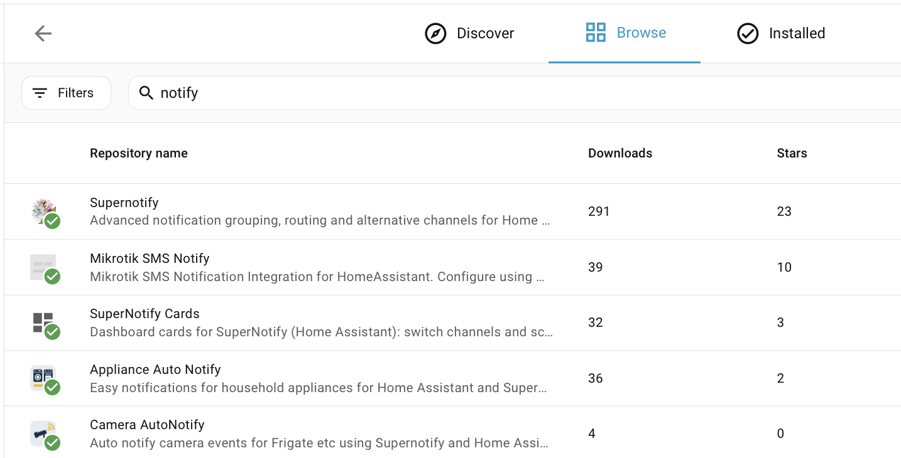

# Installation

## Installer depuis le Marketplace { #install-from-the-marketplace }

À partir de Home Assistant 2026.11, allez dans **Paramètres → Marketplace**, cherchez **Supernotify** et ouvrez-le, ou allez-y directement avec ce bouton :

Sélectionnez **Installer**, puis **Installer** à nouveau pour confirmer. Supernotify fait partie du catalogue du Marketplace, aucun dépôt personnalisé n'est donc à ajouter. Si Home Assistant doit redémarrer, une réparation dans **Paramètres → Système → Réparations** le propose. Plus d'informations dans la [documentation du Marketplace](https://www.home-assistant.io/integrations/marketplace).

## Installer depuis HACS { #install-from-hacs }

Avant Home Assistant 2026.11, le Marketplace était l'intégration distincte **HACS** : vérifiez donc d'abord que **HACS** est installé.

Sinon, consultez les [instructions HACS](https://hacs.xyz/docs/use/). Supernotify fait partie des dépôts par défaut de HACS, aucun dépôt personnalisé n'est donc à configurer.

Dans la page HACS de Home Assistant, sélectionnez **Supernotify** dans la liste des intégrations disponibles, téléchargez-le et redémarrez Home Assistant.

{width=600}

## Ajouter l'intégration { #add-the-integration }

Allez dans **Paramètres → Appareils et services → Ajouter une intégration** et cherchez **Supernotify**. Acceptez les valeurs par défaut.

{width=600}

## Détection et valeurs par défaut { #discovery-and-defaults }

C'est tout ce qu'il faut faire pour que les premières notifications fonctionnent.

Supernotify regarde ce qui existe déjà dans Home Assistant et trouve :

- **Les personnes** - tous ceux qui ont une *Personne* ou un *Utilisateur* dans Home Assistant, ainsi que les téléphones et tablettes sur lesquels ils utilisent l'application Home Assistant
- **Les moyens de notifier** - les notifications push mobiles, une intégration e-mail SMTP existante, toutes les entités notify et des appareils comme les enceintes Alexa ou les carillons, si vous en avez

Il crée une *delivery* pour chaque moyen de notifier trouvé, plus quelques-unes bien pratiques, comme `chime_siren_all` et `alexa_devices_announce_all`, si vous avez ces appareils.

L'archivage, la détection des doublons et les réglages de maintenance peuvent être modifiés ensuite depuis l'option **Configurer** de l'intégration.

Maintenant, [envoyez votre première notification](first_notification.md).
