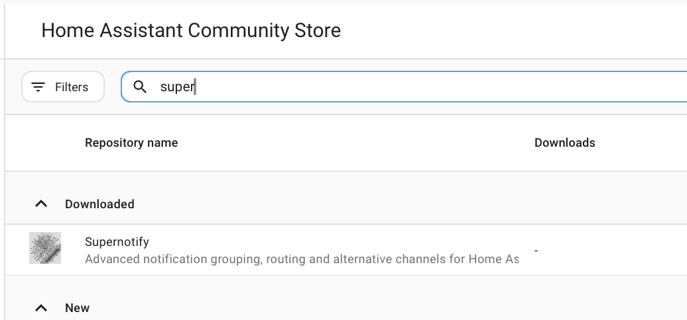

# インストール

## Marketplace からインストールする { #install-from-the-marketplace }

Home Assistant 2026.11 以降では、**設定 → Marketplace** を開いて **Supernotify** を検索して開くか、次のボタンから直接開きます。

**インストール** を選び、確認のためもう一度 **インストール** を選びます。Supernotify は Marketplace のカタログに含まれているので、カスタムリポジトリの追加は不要です。Home Assistant の再起動が必要な場合は、**設定 → システム → 修復** の修復項目から再起動できます。詳しくは [Marketplace のドキュメント](https://www.home-assistant.io/integrations/marketplace)を参照してください。

## HACS からインストールする { #install-from-hacs }

Home Assistant 2026.11 より前は、Marketplace は独立した **HACS** 統合でした。まず、**HACS** がインストールされていることを確認します。

まだの場合は [HACS の手順](https://hacs.xyz/docs/use/)を参照してください。Supernotify は HACS の標準リポジトリのひとつなので、カスタムリポジトリの設定は不要です。

Home Assistant の HACS ページで、利用可能な統合の一覧から **Supernotify** を選んでダウンロードし、Home Assistant を再起動します。

{width=400}

## 統合を追加する { #add-the-integration }

**設定 → デバイスとサービス → 統合を追加** を開き、**Supernotify** を検索します。既定値のまま進めてください。

## 自動検出と既定値 { #discovery-and-defaults }

通知を動かすために必要な作業は、ここまでですべてです。

Supernotify は Home Assistant にすでにあるものを調べ、次のものを見つけます。

- **人** - Home Assistant に *Person* または *ユーザー* がある全員と、その人が Home Assistant アプリを使っているスマートフォンやタブレット
- **通知の手段** - モバイルプッシュ、既存の SMTP メール統合、すべての notify エンティティ、そして Alexa スピーカーやチャイムなどのデバイス（ある場合）

見つかった通知手段ごとに *delivery* が作られます。該当するデバイスがあれば、`chime_siren_all` や `alexa_devices_announce_all` のような便利な delivery も追加されます。

アーカイブ、重複検出、ハウスキーピングの設定は、あとから統合の **設定** オプションで変更できます。

では、[最初の通知を送りましょう](first_notification.md)。
