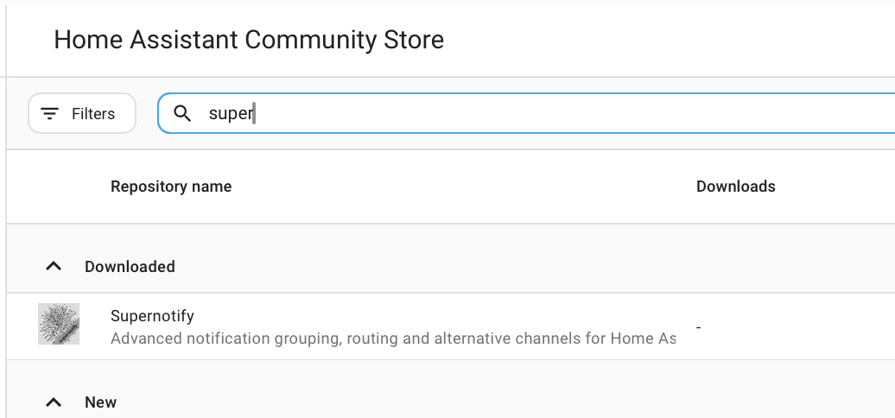
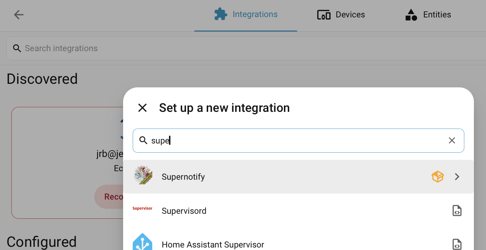

# Installatie

## Installeren via de Marketplace { #install-from-the-marketplace }

Ga vanaf Home Assistant 2026.11 naar **Instellingen → Marketplace**, zoek **Supernotify** en open het, of ga er direct heen met deze knop:

Kies **Installeren**, en ter bevestiging nogmaals **Installeren**. Supernotify staat in de catalogus van de Marketplace, dus een eigen repository toevoegen is niet nodig. Moet Home Assistant herstarten, dan biedt een reparatie onder **Instellingen → Systeem → Reparaties** dat aan. Meer in de [Marketplace-documentatie](https://www.home-assistant.io/integrations/marketplace).

## Installeren via HACS { #install-from-hacs }

Vóór Home Assistant 2026.11 was de Marketplace de aparte integratie **HACS**, dus zorg eerst dat **HACS** is geïnstalleerd.

Is dat niet zo, bekijk dan de [HACS-instructies](https://hacs.xyz/docs/use/). Supernotify is een van de standaardrepository's in HACS, dus een eigen repository instellen is niet nodig.

Kies op de HACS-pagina in Home Assistant **Supernotify** in de lijst met beschikbare integraties, download het en herstart Home Assistant.

{width=400}

## De integratie toevoegen { #add-the-integration }

Ga naar **Instellingen → Apparaten & diensten → Integratie toevoegen** en zoek naar **Supernotify**. Accepteer de standaardwaarden.

## Detectie en standaardwaarden { #discovery-and-defaults }

Meer hoef je niet te doen om de eerste meldingen te laten werken.

Supernotify kijkt naar wat er al in Home Assistant staat en vindt:

- **Personen** - iedereen met een *Persoon* of een *Gebruiker* in Home Assistant, en de telefoons of tablets waarop ze de Home Assistant-app gebruiken
- **Manieren om te melden** - mobiele pushmeldingen, een bestaande SMTP-e-mailintegratie, alle notify-entiteiten en apparaten zoals Alexa-speakers of deurbellen, als je die hebt

Voor elke gevonden manier om te melden wordt een *delivery* aangemaakt, plus een paar handige extra's, zoals `chime_siren_all` en `alexa_devices_announce_all`, als je die apparaten hebt.

Archief, detectie van duplicaten en opschooninstellingen kun je later aanpassen via de optie **Configureren** van de integratie.

[Verstuur nu je eerste melding](first_notification.md).
