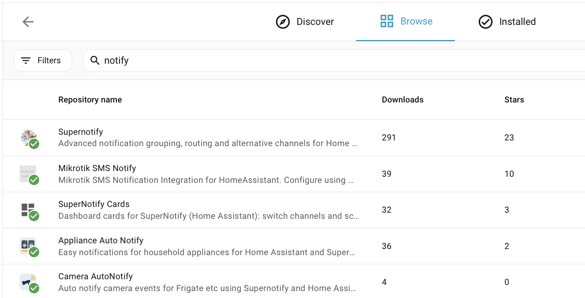

# Instalacja

## Instalacja z Marketplace { #install-from-the-marketplace }

Od Home Assistant 2026.11 przejdź do **Ustawienia → Marketplace**, wyszukaj **Supernotify** i otwórz go albo przejdź tam od razu tym przyciskiem:

Wybierz **Zainstaluj** i jeszcze raz **Zainstaluj**, aby potwierdzić. Supernotify jest w katalogu Marketplace, więc nie trzeba dodawać własnego repozytorium. Jeśli Home Assistant wymaga ponownego uruchomienia, naprawa w **Ustawienia → System → Naprawy** zaproponuje to. Więcej w [dokumentacji Marketplace](https://www.home-assistant.io/integrations/marketplace).

## Instalacja z HACS { #install-from-hacs }

Przed Home Assistant 2026.11 Marketplace był osobną integracją **HACS**, więc najpierw upewnij się, że masz zainstalowany **HACS**.

Jeśli nie, zajrzyj do [instrukcji HACS](https://hacs.xyz/docs/use/). Supernotify należy do domyślnych repozytoriów HACS, więc nie trzeba konfigurować własnego repozytorium.

Na stronie HACS w Home Assistant wybierz **Supernotify** z listy dostępnych integracji, pobierz go i uruchom ponownie Home Assistant.

{width=600}

## Dodanie integracji { #add-the-integration }

Przejdź do **Ustawienia → Urządzenia i usługi → Dodaj integrację** i wyszukaj **Supernotify**. Zaakceptuj wartości domyślne.

{width=600}

## Wykrywanie i wartości domyślne { #discovery-and-defaults }

To wszystko, czego potrzeba, aby pierwsze powiadomienia zaczęły działać.

Supernotify sprawdza, co już jest w Home Assistant, i znajduje:

- **Osoby** - każdego, kto ma *Osobę* lub *Użytkownika* w Home Assistant, wraz z telefonami i tabletami, na których korzysta z aplikacji Home Assistant
- **Sposoby powiadamiania** - powiadomienia push na telefon, istniejącą integrację e-mail SMTP, wszystkie encje notify oraz urządzenia takie jak głośniki Alexa czy dzwonki, jeśli je masz

Dla każdego znalezionego sposobu powiadamiania tworzy *delivery*, a do tego kilka pomocniczych, takich jak `chime_siren_all` i `alexa_devices_announce_all`, jeśli masz takie urządzenia.

Archiwum, wykrywanie duplikatów i ustawienia porządkowania można później zmienić w opcji **Konfiguruj** integracji.

Teraz [wyślij pierwsze powiadomienie](first_notification.md).
