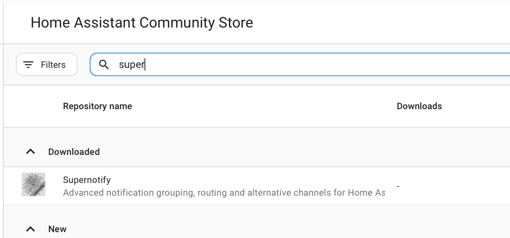

# Instalação

## Instalar pelo Marketplace { #install-from-the-marketplace }

A partir do Home Assistant 2026.11, vá a **Configurações → Marketplace**, procure **Supernotify** e abra-o, ou vá diretamente com este botão:

Selecione **Instalar** e novamente **Instalar** para confirmar. O Supernotify está no catálogo do Marketplace, por isso não é preciso adicionar um repositório personalizado. Se o Home Assistant precisar reiniciar, um reparo em **Configurações → Sistema → Reparos** oferece fazer isso. Saiba mais na [documentação do Marketplace](https://www.home-assistant.io/integrations/marketplace).

## Instalar pelo HACS { #install-from-hacs }

Antes do Home Assistant 2026.11, o Marketplace era a integração separada **HACS**, por isso primeiro confirme que o **HACS** está instalado.

Se não estiver, consulte as [instruções do HACS](https://hacs.xyz/docs/use/). O Supernotify é um dos repositórios padrão do HACS, por isso não é preciso configurar um repositório personalizado.

Na página do HACS no Home Assistant, selecione **Supernotify** na lista de integrações disponíveis, baixe-o e reinicie o Home Assistant.

{width=400}

## Adicionar a integração { #add-the-integration }

Vá a **Configurações → Dispositivos e serviços → Adicionar integração** e procure **Supernotify**. Aceite os valores padrão.

## Detecção e valores padrão { #discovery-and-defaults }

Isto é tudo o que é preciso para ter as primeiras notificações a funcionar.

O Supernotify olha para o que já existe no Home Assistant e encontra:

- **Pessoas** - todos os que têm uma *Pessoa* ou um *Usuário* no Home Assistant, e os celulares ou tablets em que usam o aplicativo do Home Assistant
- **Formas de notificar** - notificações push no celular, uma integração de e-mail SMTP existente, quaisquer entidades notify e dispositivos como alto-falantes Alexa ou campainhas, se você os tiver

Cria uma *delivery* para cada forma de notificar que encontra, além de algumas de conveniência, como `chime_siren_all` e `alexa_devices_announce_all`, se você tiver esses dispositivos.

O arquivo, a detecção de duplicados e as configurações de manutenção podem ser ajustados depois, na opção **Configurar** da integração.

Agora [envie sua primeira notificação](first_notification.md).
