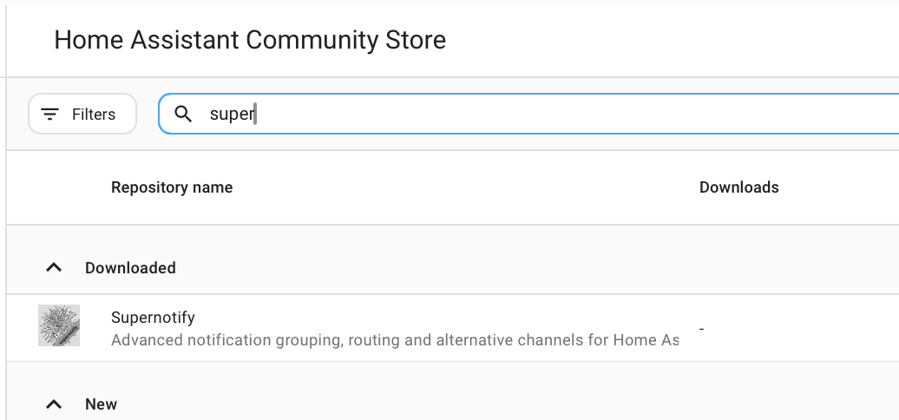

# Installation

## Install from the Marketplace

From Home Assistant 2026.11, go to **Settings → Marketplace**, search for **Supernotify** and open it, or go straight there with this button:

Select **Install**, and **Install** again to confirm. Supernotify is in the Marketplace's catalog, so there's no custom repository to add. If Home Assistant needs a restart, a repair under **Settings → System → Repairs** offers to do it. See the [Marketplace documentation](https://www.home-assistant.io/integrations/marketplace) for more.

## Install from HACS

Before Home Assistant 2026.11, the Marketplace was the separate **HACS** integration, so first make sure you have **HACS** installed.

If not, check the [HACS Instructions](https://hacs.xyz/docs/use/). Supernotify is one of the default repositories in HACS so no custom repo configuration required.

From the HACS page on Home Assistant, select **Supernotify** in the list of available integrations, download it, and restart Home Assistant.

{width=400}

## Add the Integration

Go to **Settings → Devices & Services → Add Integration** and search for **Supernotify**. Accept the defaults.

## Discovery and Defaults

Above is everything you need to do to get some notifications working.

Supernotify looks at what is already in Home Assistant and finds:

- **People** - everyone with a *Person* or a *User* in Home Assistant, and the phones or tablets they run the Home Assistant app on
- **Ways to notify** - mobile push, an existing SMTP e-mail integration, any notify entities, and devices like Alexa speakers or chimes if you have them

It builds a *delivery* for each way to notify it finds, plus some convenience ones, like `chime_siren_all` and `alexa_devices_announce_all`, if you have those devices.

Archive, duplicate detection and housekeeping settings can be adjusted afterwards from the integration's **Configure** option.

Now [send your first notification](first_notification.md).
