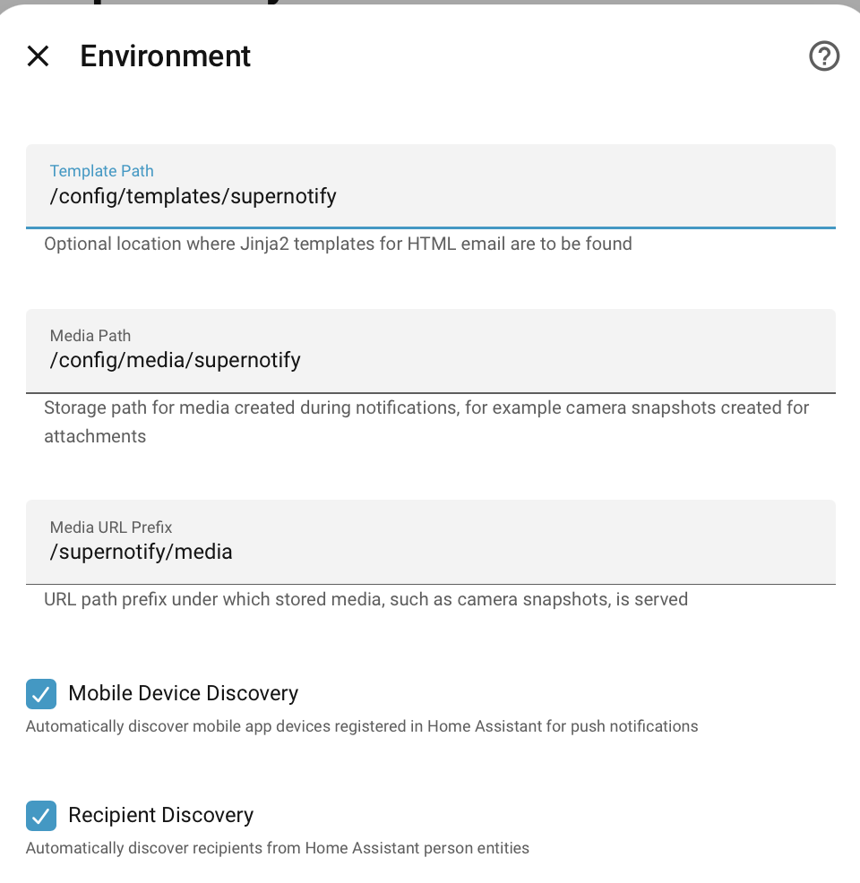

---
tags:
  - transport
  - email
  - smtp
  - html_email
---
# Email Transport Adaptor

| Transport ID | Source                                                                                                                                | Requirements | Optional                                                                                                                                                                                                     |
|--------------|---------------------------------------------------------------------------------------------------------------------------------------|--------------|--------------------------------------------------------------------------------------------------------------------------------------------------------------------------------------------------------------|
| `email`      | :material-github:[`email.py`](https://github.com/rhizomatics/supernotify/blob/main/custom_components/supernotify/transports/email.py) | -            | :material-home-assistant: [SMTP Integration](https://www.home-assistant.io/integrations/smtp/), :material-home-assistant: [Google Mail Integration](https://www.home-assistant.io/integrations/google_mail/) |


Can be used for plain or HTML template emails, and handle images as attachments or embedded HTML.

## Discovery

**Default delivery.** If no `email` delivery is defined, an `email` delivery is generated automatically
and fires on every notification, when either:

- a [direct connection](#direct-connection) with a `sender` is configured, or can be reused from the Home Assistant SMTP integration
- the Home Assistant SMTP integration's notify action is available

To stop it being generated, switch the transport off:

```yaml
transports:
  email:
    enabled: false
```

## Example

```yaml title="Example Notification"
- action: supernotify.notify
  data:
    message: "Motion detected at the front door"
    priority: high
    target:
        - homeowner@example.com
```

## Data

Supernotify's own `message_html` becomes the `html` of the email. Anything else in `data`, or in
`extra_data` on `supernotify.notify`, is passed on to the integration as it is, such as the
SMTP integration's own `html` and `images`, or Google Mail's `cc`, `bcc` and `from` for a delivery
with `action: notify.google_mail`. An `html` given that way wins over `message_html`, and any
snapped image is added to the `images` given.

```yaml title="Example Notification with Pass-through Data"
- action: supernotify.notify
  data:
    message: "Motion detected at the front door"
    target:
        - homeowner@example.com
    extra_data:
      images:
        - /config/www/floorplan.png
```

These keys in `data` are Supernotify's own, and not passed on:

| Key                | Usage                                                                                                  |
|--------------------|--------------------------------------------------------------------------------------------------------|
| `template`         | Template to use instead of the delivery's `template`                                                   |
| `footer`           | Text added at the end of a plain email, with `{e}` for the delivery envelope, for example `{e.delivery_name}`. Not used with a template |
| `action_url`       | `action_url` for the template                                                                          |
| `action_url_title` | `action_url_title` for the template                                                                    |

!!! note
    The legacy `notify.supernotify` action needed a `data` inside `data` for what went to the integration.
    That still works, with a warning in the log, but the keys belong directly in `data` or `extra_data`.

## Pre-generated HTML

The notification can have a `message_html` supplied for html that will be used in place of the standard `message` for HTML emails and ignored for other notification types. This does not require templates, see the [Restart Email Recipe](../recipes/restart_email.md) for a simple example. In this case, HTML will automatically be tagged onto the end to include any attached images. It can be set in fixed configuration, in the `data` of a delivery or scenario, or as `message_html` in the action call.

## HTML Templates

HTML templates use the standard Home Assistant Jinja2 [Templating](https://www.home-assistant.io/docs/configuration/templating) with access to entity states, additional filters etc.

Templates are read once and kept, so restart Home Assistant after changing one.

Padding to nudge e-mail clients from reading too deeply into the e-mail for in-box summaries can be tuned with `preheader_blank` and `preheader_length` configuration in the transport `options`. The other useful option is `strict_template` to switch on or off the stricter
Jinja2 template validation.

### Configuration

Supernotify ships with a built in template, `default.html.j2` which can be used by setting `template: default.html.j2` on the delivery. This shouldn't be edited directly, since changes will get overwritten by future releases. Instead, write your own, or amended versions of [`default.html.j2`](https://github.com/rhizomatics/supernotify/blob/main/custom_components/supernotify/default_templates/email/default.html.j2) and put
it into a custom template directory, usually inside Home Assistant's `\config` directory. Templates can live in this directory, or in an `email` subdirectory ( the top-level is for templates that could be used with any transport, and `email` only for this one).



Once a template is in that directory, set it as the `template` of an email delivery, and select that delivery when sending a notification:

```yaml title="Delivery Using a Custom Template"
supernotify:
  delivery:
    back_door_email:
      transport: email
      template: back_door.html.j2
```

```yaml title="Notification Using That Delivery"
- action: supernotify.notify
  data:
    title: Motion at the back door
    message: Motion has been detected at the back door
    target:
      - homeowner@example.com
    delivery: back_door_email
```

### Template Variables

Supernotify also adds an `alert` variable for context of the current notification, with these values:

| Attribute         | Description                                                                                |
|-------------------|--------------------------------------------------------------------------------------------|
| message           | Notification message                                                                       |
| title             | Notification title                                                                         |
| preheader         | Invisible `div` contents at top of html used to show info below heading                    |
| priority          | Notification priority                                                                      |
| envelope          | Delivery Envelope (complex nested object)                                                  |
| subheading        | "Home Assistant Notification", in the Home Assistant language                              |
| server            | Access to `name`,`language`,`internal_url` and `external_url` of this HomeAssistant server |
| preformatted_html | HTML supplied to the notify action, for example by an Automation                           |
| action_url        | Action URL for mobile action                                                               |
| action_url_title  | Title for the Action URL                                                                   |
| img               | Snapshot image attachment, with `url` and `desc` fields                                    |

The `preheader` defaults to a minimum 100 characters packed with `&#847;&zwnj;&nbsp;` to force e-mail clients
not to dig into the message contents when showing a preview in the in-box.

### Image Attachments

Where the image is snapped rather than being only a URL, it will be included as an attachment and
an `cid:XXXX` URL generated to point to the attachment name.

## Direct Connection

By default, Supernotify uses its own SMTP connection rather than the Home Assistant one. The Home Assistant SMTP integration is moving to recipients set up one by one as notify entities, rather than any address given at the time, and its notify action has no e-mail priority.

If you already have the SMTP integration installed, Supernotify can reuse the connection details automatically if it was set up from the UI (but not if its defined in YAML). Or you can skip that altogether and use the `connection` section of the Supernotify transport to define it directly.

If you really want to use only the native Home Assistant integration, then override the defaults using `mode: ha_smtp` in the `options` section of a delivery or transport, see section below on configuring.

### Configuring

By default, the `mode` option is set to `direct`, so deliveries go through Supernotify's own SMTP capability rather than the Home Assistant notify integration. This can be set at transport level or at delivery level (if you have multiple email deliveries, such as HTML and plain).

```yaml
transports:
  email:
    delivery_defaults:
      options:
        mode: direct
        sender: hass@example.com
        sender_name: Home Assistant
```

As for the Home Assistant SMTP integration, a `sender` is needed: without one, direct emails aren't sent,
no default delivery is generated, and a warning is logged at startup. The email is from the `sender` alone
unless a `sender_name` is given. `sender`, `sender_name` and `default_title` can also be set in the
`options` of a single delivery, to send that delivery's emails from a different address.

This avoids using the built in [Home Assistant SMTP Integration](https://www.home-assistant.io/integrations/smtp/), with the same functionality but without setting up each email address in Home Assistant first.

In addition to reverting to the previous simpler Home Assistant usage, it also offers:

#### Priority

Envelope priority is mapped to common header fields used for internet mail:

- Priority
- Importance
- X-Priority
- X-MSMail-Priority

#### Message-ID

`Message-Id` in email header ties back to notification ID and delivery name. (Your mail relay may override this).

### Example Config

Connections default to `STARTTLS` over port 587, though can be changed to other ports or without encryption. This will work with Amazon SES, local mail relays etc.

`connection` is only used by deliveries that set `mode: direct` - other `email` deliveries on the same transport can still go via an `action` as normal.

```yaml
transports:
  email:
    connection:
      host: smtp.local.net
      port: 587
      encryption: starttls
      username: postie
      password: blackandwhitecat
      verify_ssl: false
    delivery_defaults:
      options:
        sender: hass@local.net
        sender_name: Your Friendly Home Assistant
        default_title: Home Assistant Notification

delivery:
  direct_mail:
    transport: email
    options:
      mode: direct
    target: mailarchive@mymail.com
```

In addition, all of the other `email` options are available, such as for tuning PNG attachments or preheaders for message previews.

### Reusing the Home Assistant SMTP Integration Configuration

If no `connection` block is configured, this transport falls back to the connection details (server, port, encryption, username, password, `verify_ssl`, sender, sender name) from a configured [SMTP Integration](https://www.home-assistant.io/integrations/smtp/) config entry, so you don't have to duplicate credentials. This only applies to ConfigFlow (UI) based SMTP integration setups, not the legacy YAML `platform: smtp` style. Omit `connection` entirely to use this.


### Roadmap

Initially this only preserves the original easier to use functionality of Home Assistant SMTP prior to the enforcement of pre-registering every e-mail address as an `entity`, and mapping envelope priority to common headers.

It is anticipated that this will also open up more features, such as modern email features like DKIM.


## Reference

### Home Assistant Core
- [SMTP Integration](https://www.home-assistant.io/integrations/smtp/)
    - [Open Issues](https://github.com/home-assistant/core/issues?q=is%3Aissue%20label%3A%22integration%3A%20smtp%22%20state%3Aopen)
- [Templating](https://www.home-assistant.io/docs/configuration/templating/)
### Home Assistant Other
- [Mastering Dynamic HTML Email Alerts in Home Assistant: Secure SMTP & Custom Content](https://newerest.space/home-assistant-dynamic-html-email-alerts-secure-smtp-custom-content/)
### General
- [MailChimp HTML Email Template Guide](https://templates.mailchimp.com)
- [Jinja2 Template Designer Documentation](https://jinja.palletsprojects.com/en/stable/templates/)
